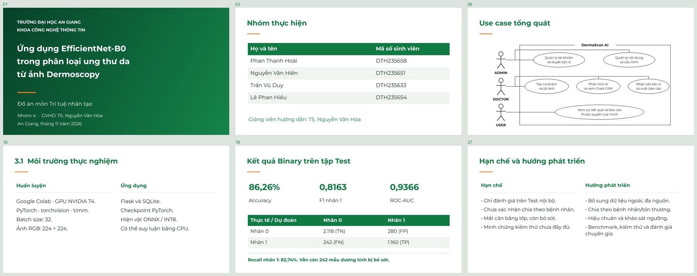

# DermaScan AI — V3 · Montserrat

Bộ 28 slide môn Trí tuệ nhân tạo. Bố cục học thuật, nền trắng, tiêu đề xanh và điểm nhấn cam. Đã bỏ các nhãn trang trí và chữ nguồn nhỏ; nguồn và giải thích được chuyển vào ghi chú.

## Chọn đúng file

- **[DermaScan_AI_ThuyetTrinh.pptx](DermaScan_AI_ThuyetTrinh.pptx)** — mở để trình chiếu. Mỗi trang là ảnh slide 1920×1080 được nhúng trực tiếp, giữ nguyên nền và chữ mà không cần cài font. Không chỉnh sửa chữ trực tiếp trong bản này.
- **[DermaScan_AI_ChinhSua.pptx](DermaScan_AI_ChinhSua.pptx)** — bản chỉnh sửa chữ, bảng và biểu đồ. Cài [Montserrat](fonts) trước khi mở. Nền bìa là PNG nhúng trực tiếp.
- **[PDF](DermaScan_AI_ThuyetTrinh.pdf)** — xem và trình chiếu nhanh.
- **[ZIP trọn bộ](DermaScan_AI_TronBo.zip)** — cả hai PowerPoint, PDF, font, ghi chú và sơ đồ.

## Sơ đồ

- [Use case](UseCase.png)
- [Class diagram](ClassDiagram.png)
- [File UML](DermaScan_AI_WhiteStarUML.uml)

Actor người que, ellipse và lớp dữ liệu được dựng thành ảnh từ dữ liệu file `.uml`. **Đây không phải ảnh chụp trực tiếp WhiteStarUML**; máy thực hiện không có phần mềm đó. Sơ đồ trên slide là bản tổng quan rút gọn, file UML có thêm chi tiết. File UML đã kiểm tra cấu trúc và tham chiếu, chưa mở trực tiếp trong WhiteStarUML.

## Nội dung và kiểm tra

Số liệu theo báo cáo: Binary Accuracy **86,26%**, ROC-AUC **0,9366**; Multi-class Accuracy **81,63%**, Macro-F1 **0,7547**. Test nội bộ 3.800 ảnh. Colab/T4 theo thông tin người dùng. Slide 25 chỉ có **DEMO**.

Đã kiểm tra: 28 trang; toàn bộ chữ trong bản chỉnh sửa xuất đủ sang PDF; font Montserrat hỗ trợ tiếng Việt; nền PNG và các quan hệ ảnh nhúng hợp lệ; ảnh của cả 28 trang trong bản trình chiếu khớp từng byte với ảnh đã xuất. Bản trình chiếu được mở lại và xuất thử trong LibreOffice mà không nạp Montserrat, nền bìa vẫn giữ được. Chưa chạy PowerPoint trên Windows trong môi trường này.

[Ghi chú thuyết trình và nguồn](Ghi_chu_thuyet_trinh.md) · [Lưu ý sử dụng](DOC_TRUOC.txt)
