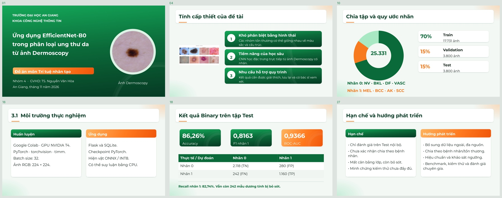

# DermaScan AI — V5

28 slide, font Montserrat. Giữ nguyên nội dung V4; thiết kế theo giao diện DermaScan AI: xanh gradient đậm, điểm nhấn cam gradient, thẻ trắng bo góc, bóng nhẹ và một ít icon nét mảnh.



## File trình bày

- **[PowerPoint trình chiếu](DermaScan_AI_ThuyetTrinh.pptx)** — giữ cố định hình thức bằng ảnh 1920×1080 nhúng trực tiếp, không cần cài font. Không sửa chữ trực tiếp trong bản này.
- **[PowerPoint chỉnh sửa](DermaScan_AI_ChinhSua.pptx)** — sửa được chữ, bảng và biểu đồ. Cài [Montserrat](fonts) trước khi mở.
- **[PDF](DermaScan_AI_ThuyetTrinh.pdf)** — xem nhanh.
- **[ZIP trọn bộ](DermaScan_AI_TronBo.zip)** — cả hai PowerPoint, PDF, font, nền và sơ đồ.

## Nền theo CSS được yêu cầu

Trang nội dung dùng nền sáng với cam ở góc trên phải, xanh ở góc dưới trái. Bìa, DEMO và trang kết dùng nền xanh gradient. Các nền và thẻ gradient được render từ CSS rồi nhúng vào PowerPoint.

```css
background-image:
  radial-gradient(300px 180px at 100% 0%, rgba(255, 138, 43, 0.28), transparent 70%),
  radial-gradient(320px 200px at 0% 100%, rgba(44, 197, 111, 0.22), transparent 70%) !important;
```

[Nền PNG để tái sử dụng](Nen_radial_gradient.png) · [CSS gốc](BACKGROUND_CSS.txt)

## Nội dung và kiểm tra

Giữ các số liệu V3 từ báo cáo: Binary Accuracy **86,26%**, ROC-AUC **0,9366**; Multi-class Accuracy **81,63%**, Macro-F1 **0,7547**. Test nội bộ 3.800 ảnh. Colab/T4 theo thông tin người dùng. Slide 25 chỉ có **DEMO**. Learning rate `10^-3` được viết tương đương `0,001` để tránh lỗi ký tự mũ.

Đã đối chiếu chữ, bảng, dữ liệu biểu đồ và ghi chú với V4; kiểm tra đủ 28 trang, font Montserrat, nội dung xuất PDF và ảnh nền nhúng. Bản trình chiếu dùng ảnh toàn trang để không phụ thuộc font máy mở. Chưa chạy PowerPoint trên Windows trong môi trường này.

[Sơ đồ use case](UseCase.png) · [Sơ đồ lớp](ClassDiagram.png) · [File UML](DermaScan_AI_WhiteStarUML.uml) · [Ghi chú và nguồn theo slide](Ghi_chu_thuyet_trinh.md)

Ảnh UML giữ từ V3, dựng từ dữ liệu file `.uml`, không phải ảnh chụp trực tiếp WhiteStarUML. Xem [lưu ý](DOC_TRUOC.txt).
