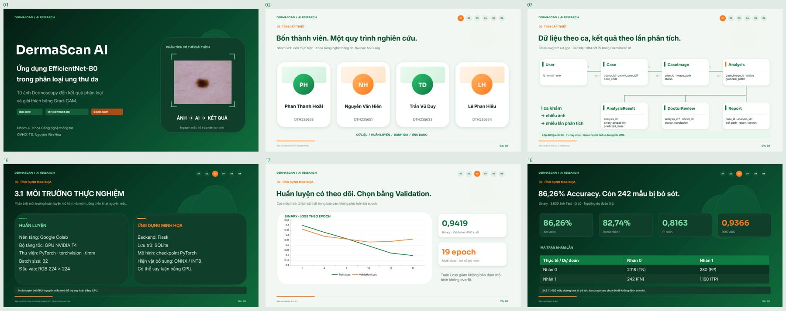

# DermaScan AI — Slide V2 theo CSS website

Bộ **28 slide môn Trí tuệ nhân tạo**, khổ 16:9. Phiên bản V2 thiết kế lại theo `dermascan-theme.css`: gradient xanh/cam, nền sáng và xanh đậm, góc bo, bóng mềm, chữ Sora/Inter.

## File trình bày

- [PowerPoint chỉnh sửa được](DermaScan_AI_ThuyetTrinh.pptx)
- [PDF đã nhúng font](DermaScan_AI_ThuyetTrinh.pdf)
- [Trọn bộ ZIP gồm font và sơ đồ](DermaScan_AI_TronBo.zip)
- [Ghi chú thuyết trình và nguồn theo slide](Ghi_chu_thuyet_trinh.md)

**Cài font trong thư mục [fonts](fonts) trước khi mở PowerPoint**: trên Windows, chọn các file `.ttf`, nhấn chuột phải → Install. PDF xem đúng kiểu chữ mà không cần cài font.

## Thay đổi trong V2

- Bìa hero và trang DEMO nền xanh đậm, gradient theo website.
- Trang thành viên có avatar chữ cái và nhịp màu xanh/cam.
- Phân cấp chữ và khoảng trắng rõ hơn; phối trang sáng/tối theo nội dung.
- Sơ đồ use case/class trên slide bằng các khối PowerPoint chỉnh sửa được.
- Biểu đồ phân bố dữ liệu và F1 đồng bộ màu; bổ sung đường loss từ các mốc thực trong báo cáo.
- Ảnh ứng dụng trong khung trình duyệt; Grad-CAM từ hiện vật thật.
- Sora thiếu một số ký tự tiếng Việt: các dòng liên quan dùng Inter để giữ đầy đủ dấu.

Giữ số liệu từ báo cáo: Binary Accuracy **86,26%**, ROC-AUC **0,9366**; Multi-class Accuracy **81,63%**, Macro-F1 **0,7547**. Google Colab/GPU T4 theo thông tin người dùng. Slide 25 chỉ có **DEMO**.

## Sơ đồ độc lập

- [WhiteStarUML .uml](DermaScan_AI_WhiteStarUML.uml)
- [Use case PNG](UseCase.png) · [SVG](UseCase.svg)
- [Class diagram PNG](ClassDiagram.png) · [SVG](ClassDiagram.svg)

File UML đã kiểm tra cấu trúc và liên kết XML, chưa mở trực tiếp trên WhiteStarUML. Sơ đồ trên slide là bản rút gọn; file UML có thêm các liên kết dữ liệu. Xem [DOC_TRUOC.txt](DOC_TRUOC.txt) để biết các lưu ý.
