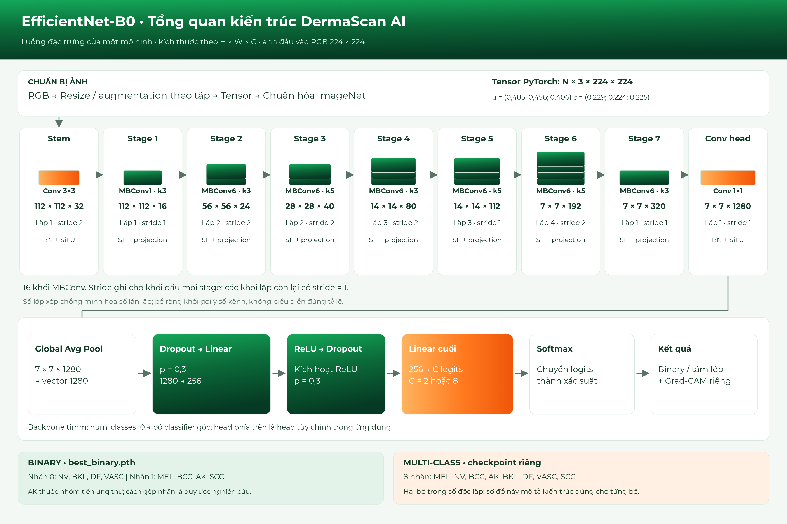
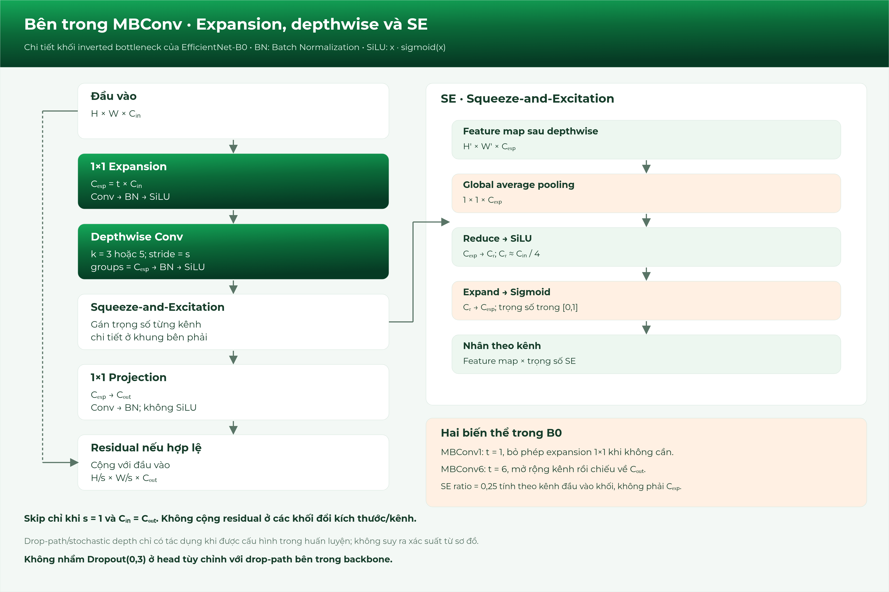
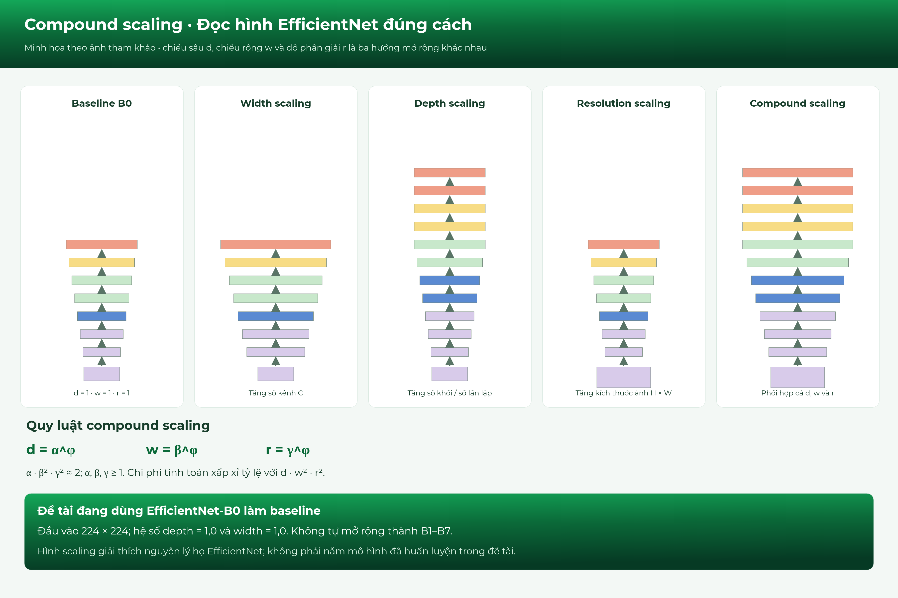

# Sơ đồ kiến trúc DermaScan AI

Ba hình chi tiết, trình bày bằng Montserrat, xanh gradient và cam. Bộ slide V5 giữ nguyên; sơ đồ được giao riêng để xem trước.

## 1. Tổng quan mô hình

[PNG 3600×2400](01_Tong_quan_EfficientNet_B0.png) · [SVG vector](01_Tong_quan_EfficientNet_B0.svg)

Ảnh RGB → chuẩn hóa → stem → 7 stage / 16 MBConv → conv 1280 → global average pooling → head tùy chỉnh → Softmax. Ghi rõ kích thước tensor đầu ra, kernel, stride đầu stage, số lần lặp và nhóm nhãn. Binary và Multi-class là hai checkpoint độc lập, không phải hai head chung một bộ trọng số backbone.

## 2. MBConv và SE

[SVG vector](02_Chi_tiet_MBConv_SE.svg). Expansion, depthwise convolution, SE, projection tuyến tính và điều kiện residual. Stage đầu là depthwise-separable block (MBConv1) trong timm; không có expansion 1×1. Các stage sau dùng MBConv6. SE bottleneck lấy tỷ lệ 0,25 theo số kênh đầu vào khối.

## 3. Compound scaling

[SVG vector](03_Nguyen_ly_Compound_Scaling.svg). Học cách biểu diễn từ ảnh tham khảo: baseline, width, depth, resolution và compound scaling. Đây là minh họa nguyên lý EfficientNet, không phải năm thí nghiệm của đề tài. Số tầng và bề rộng trong hình này mang tính minh họa.

## Tải trọn bộ

- [PDF ba trang](So_do_kien_truc_DermaScan_AI.pdf)
- [PowerPoint ba hình](So_do_kien_truc_DermaScan_AI.pptx): mỗi trang là ảnh chất lượng cao, chữ không sửa trực tiếp. Muốn chỉnh sơ đồ, dùng SVG.
- [ZIP](So_do_kien_truc_DermaScan_AI.zip)

## Đối chiếu nguồn

- Mã dự án: [SkinCancerEfficientNet và pipeline suy luận](../../../../skin_cancer/webapp/app.py), khoảng dòng 309–343 và 437–445. `timm.create_model('efficientnet_b0', pretrained=False, num_classes=0)`; head `Dropout(0.3) → Linear(1280,256) → ReLU → Dropout(0.3) → Linear(256,C)`; Softmax ở bước suy luận. `pretrained=False` khi khởi tạo để nạp checkpoint, không dùng nó để kết luận quá trình huấn luyện không sử dụng pretrained weights.
- Cấu trúc backbone: [timm / _gen_efficientnet](https://github.com/huggingface/pytorch-image-models/blob/main/timm/models/efficientnet.py). Đã đối chiếu 7 stage, stem32 và conv head1280; không chạy forward checkpoint trong phiên tạo sơ đồ này.
- Compound scaling: [Tan & Le, EfficientNet, 2019](https://arxiv.org/abs/1905.11946).
- Quy ước nhãn và dữ liệu: báo cáo DermaScan AI người dùng cung cấp.

Grad-CAM dùng feature map và gradient theo lớp mục tiêu, không tính từ vector xác suất đơn thuần. Dòng “+ Grad-CAM riêng” trong sơ đồ tổng quan chỉ một bước giải thích bổ sung, không nằm trong forward phân loại cơ bản.
