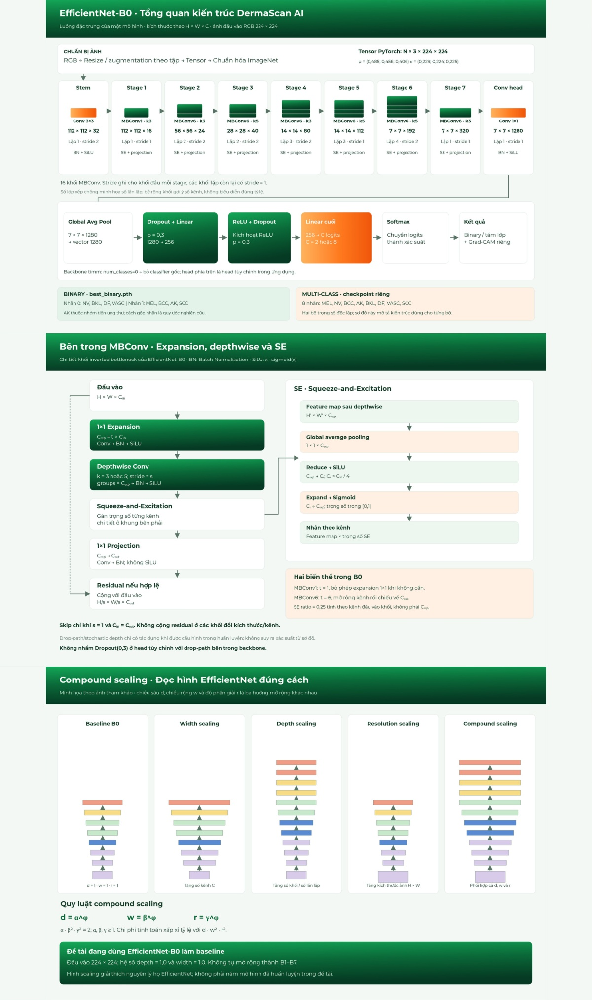

# Bản lồng ghép đúng ba hình gốc — 35 trang

[PowerPoint cập nhật](DermaScan_AI_LongGhep_MoHinh.pptx) · [PDF](DermaScan_AI_LongGhep_MoHinh.pdf) · [Xem trước](Xem_truoc_3_trang_mo_hinh.jpg)

Dùng file người dùng gửi `DermaScan_AI_ThuyetTrinh_Moi (1).pptx` làm bản gốc. Giữ 32 trang nội dung gốc và chèn sau trang 14:

15. EfficientNet-B0 — Tổng quan kiến trúc DermaScan AI.
16. Bên trong MBConv — Expansion, depthwise và SE.
17. Compound scaling — nguyên lý mở rộng EfficientNet.

Ba trang trên dùng **đúng ảnh sơ đồ gốc 3600×2400**, giữ nguyên bố cục, màu, chữ và tỷ lệ; không dựng lại thành các ô chữ rút gọn. Ảnh 3:2 được đặt giữa trang 16:9 nên có nền trống hai bên. Không cắt nội dung hoặc kéo méo hình.

Chữ trong ba hình không sửa trực tiếp được; [SVG gốc để chỉnh sửa](../architecture) vẫn có trong kho. Các trang khác giữ khả năng chỉnh sửa của file người dùng gửi.

Kiểm tra: 35 trang; XML của 32 trang ngoài phần thay thế giữ nguyên so với bản lồng ghép trước. Ba ảnh nhúng giống từng byte với ảnh nguồn, không crop, đúng tỷ lệ. Đã xem bản PDF xuất ra để kiểm tra hình thức; chưa chạy PowerPoint Windows.

