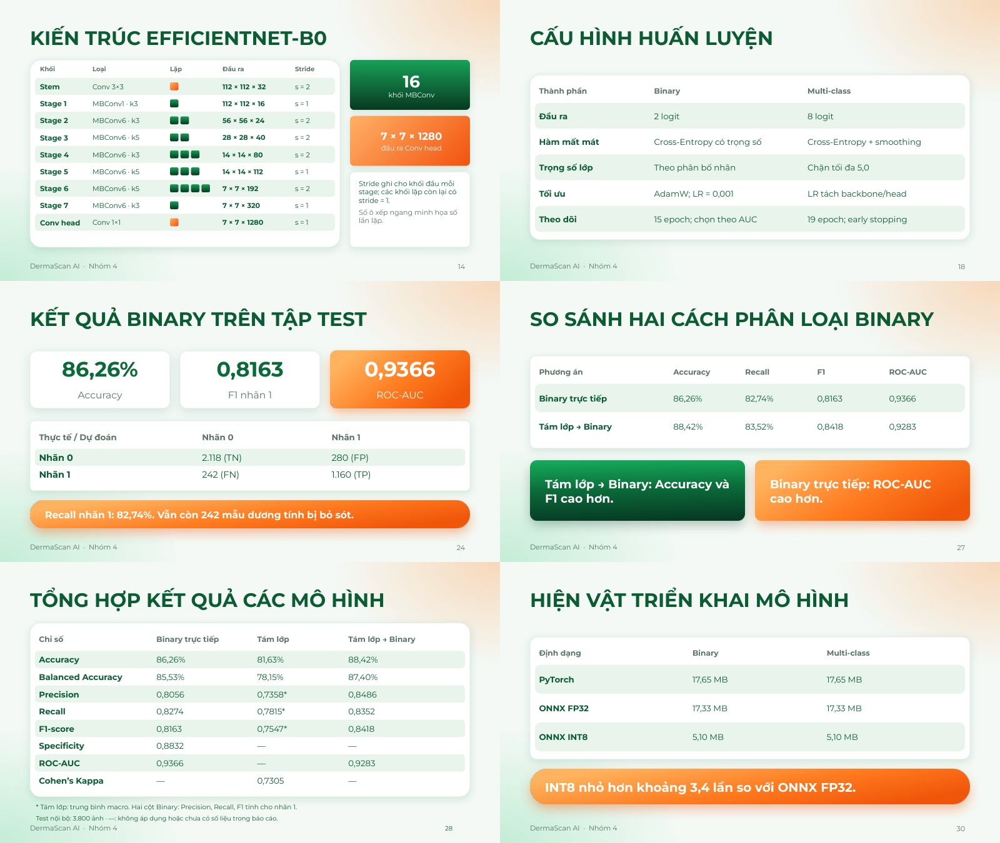

# Bản bổ sung bảng kết quả và đồng bộ kiểu bảng — 36 trang

Bản gốc: **DermaScan_AI_ThuyetTrinh_Moi_3.pptx** do người dùng gửi.

- **[PowerPoint cập nhật](DermaScan_AI_Moi_3_BoSungBang.pptx)**
- [PDF xem nhanh](DermaScan_AI_Moi_3_BoSungBang.pdf)
- [Xem trước các bảng](Xem_truoc_cac_bang.jpg)

## Hai thay đổi

1. Thêm **trang 28: Tổng hợp kết quả các mô hình**, sau trang so sánh hai cách phân loại Binary. Bảng có Binary trực tiếp, mô hình tám lớp và phương án quy đổi tám lớp → Binary; các hàng Accuracy, Balanced Accuracy, Precision, Recall, F1, Specificity, ROC-AUC và Cohen’s Kappa.
2. Chỉnh bốn bảng hiện có (cấu hình huấn luyện, ma trận Binary, so sánh Binary, dung lượng hiện vật) theo **slide14**: khung trắng bo góc, bóng nhẹ, hàng xanh nhạt xen kẽ, chữ Montserrat xanh và tiêu đề cột xanh xám. Slide14 giữ nguyên.

Các bảng được dựng bằng chữ và hình khối chỉnh sửa được, giống cách dựng bảng slide14. Giữ nội dung và số liệu 35 trang gốc; cập nhật số trang. Không đổi sơ đồ hoặc thiết kế các phần đã duyệt.

## Cách đọc bảng tổng hợp

- Precision / Recall / F1 của hai cột Binary tính cho nhãn1; cột tám lớp dùng trung bình macro, đánh dấu `*` trên slide.
- `—` là không áp dụng hoặc chưa có số liệu trong báo cáo, không phải0.
- Tám lớp → Binary là cách quy đổi đầu ra, không phải checkpoint thứ ba.
- Các nhiệm vụ có số nhãn khác nhau: không dùng Accuracy/F1 trong bảng này để kết luận mô hình tám lớp tốt/xấu hơn mô hình Binary.
- Nguồn: báo cáo DermaScan AI §4.4–4.6, Bảng4.5 và4.10; Macro-Precision khoảng0,7358, Macro-Recall0,7815 và Macro-F10,7547 từ §4.5.2. Test nội bộ3.800 ảnh.

Đã kiểm tra nội dung và ghi chú 35 trang gốc, số liệu của bốn bảng, slide14 giữ nguyên; đã xuất và xem PDF. Chưa mở trực tiếp bằng PowerPoint Windows.

